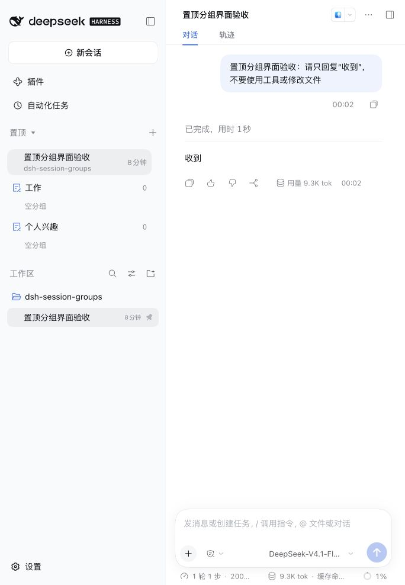

# DSH Session Groups

DSH Session Groups 是一个独立安装的 DeepSeek Harness Web 插件。在不修改 DSH 源码的前提下，它在原生 Workspace 项目树上方增加一个跨项目“置顶”区域，并允许用户把置顶 Session 整理到自定义分组中。

## 预览状态

版本 `0.1.0` 已发布到公共 npm，用户只需安装 [@umialpha/dsh-session-groups](https://www.npmjs.com/package/@umialpha/dsh-session-groups)。四包下载完整性、全新 profile 的公开安装、启动、移除和官方 Workspace 恢复验证已通过。当前仍为 alpha 预览；真实鼠标拖入置顶、组间移动及拖放排序仍待验收，不作为已通过的浏览器能力宣传。



## 功能

- 保留官方 Workspace 的真实目录发现、项目树、搜索、原生置顶、Session 操作和导航行为。
- “置顶”和“工作区”作为同级区块显示；置顶整体可折叠，在搜索和列表模式中仍可见，不使用 tab，也不显示“未分组”标签。
- 空安装通过现有入口选择真实文件夹，不自动创建默认工作区目录；已有工作区和 Session 正常保留。
- 创建、重命名、删除、折叠和排序命名分组。
- 在默认层、组内和组间拖动 Session。
- 从任意项目直接拖入未置顶 Session；插件先调用原生置顶，再保存目标位置。
- 删除分组时只移除布局分组，成员仍保持置顶。
- 刷新或重启 DSH 后保留分组与顺序。

分组只是原生置顶集合的布局。它不会改变 Session 的项目归属、cwd 或项目内原生顺序，Session 仍显示在原项目中。

## 兼容性

| 插件版本 | DeepSeek Harness | Cordis |
|---|---|---|
| `0.1.0` | `0.2.1-alpha.2` | `4.0.5-alpha.1` |

当前版本只支持表中的精确 DSH 版本。bundle 的 peer dependency 会在读取替换配置前拒绝不兼容版本，避免出现官方 Workspace 已停用但替代入口无法加载的半激活状态。

DSH 的 npm `latest` 当前为 `0.2.0-rc.2`，不在支持范围内；请显式使用上表 alpha 版本，不要只安装未指定版本的 `@deepseek-ai/dsh`。

## 安装

只安装 bundle；另外三个运行包会作为依赖自动安装：

```sh
npm install -g @deepseek-ai/dsh@0.2.1-alpha.2
dsh plugin --profile web add @umialpha/dsh-session-groups@0.1.0 --registry=https://registry.npmjs.org/
dsh web
```

不需要修改 DSH 源码、profile YAML 或 Workspace 配置。安装命令显式使用 npm 官方源，避免镜像尚未同步新包时返回 404，不会修改全局 registry 配置。请打开本次 `dsh web` 输出的完整 URL；旧端口或缺少认证参数的 URL 可能显示 `dsh web authentication required`。

如果测试本仓库的开发版本，请先执行 `pnpm run build` 和安装 smoke；不要只链接 bundle 而遗漏另外三个 workspace 包。

本地安装 smoke 使用临时 `DSH_HOME` 和四包 tarball，只用于开发验证，不会把插件安装到你的日常 Web profile。

## 使用

1. 继续使用原生“置顶”操作，或把项目树中的 Session 拖到顶部置顶区域。
2. 点击置顶标题右侧的新增按钮创建分组。
3. 拖动普通 Session、命名分组或组内 Session 调整布局。
4. 分组中的 Session 菜单可重命名、分叉、归档、移出分组或取消置顶。

blank Session 仍可打开，但没有时间、操作菜单或拖动能力。它在产生第一条内容并成为普通 Session 后恢复这些行为。

置顶整体折叠状态在当前页面内保留，刷新默认展开；分组与 Session 的顺序仍持久保存。已有自动目录在插件侧显示存储标题 <code>default-workspace</code>；官方 composer 对该历史标题仍会显示本地化默认名称，可通过工作区菜单自行重命名，插件不会改动用户目录或标题。

## 数据与恢复

`WorkspaceRegistry.pinnedSessionIds` 始终是置顶成员资格的唯一权威。插件只在 `pinned_session_groups` storage domain 保存分组标题、组顺序和置顶 Session 的布局顺序。

移除插件会恢复官方 Workspace；原生置顶集合和 Session 数据不会被删除，分组 sidecar 数据会保留以供以后重新安装：

```sh
dsh plugin --profile web remove @umialpha/dsh-session-groups
dsh web
```

如果插件入口激活失败，也使用上面的移除命令并重启 Web profile。Client HMR 不是跨入口事务，失败时不会自动恢复官方 Workspace。

## 开发与验证

要求 Node.js `^22.19.0 || >=24.0.0` 和 pnpm `11.28.5`。

```sh
pnpm install
pnpm run typecheck
pnpm run lint
pnpm run build
pnpm exec vitest run packages/client/ui-session-groups/tests
node tests/install/session-groups.smoke.mjs --dsh-cli /absolute/path/to/dsh
node tests/install/session-groups.smoke.mjs --public --dsh-cli /absolute/path/to/dsh
```

`--public` 使用公共 npm 中的四包，不构建、不打包、不添加本地 overrides；测试隔离 npm/pnpm 认证配置，仅操作临时 `DSH_HOME`。官方 CLI 版本也必须为 `0.2.1-alpha.2`。

当前完整实现任务与验证记录见 [T-002](tickets/T-002-complete-session-groups.html)。历史设计与评审材料可从 Git 历史查阅。

## 作者与反馈

作者：[`umialpha`](https://github.com/umialpha) · [roy236977634@gmail.com](mailto:roy236977634@gmail.com)。问题和建议请提交到 [GitHub Issues](https://github.com/umialpha/dsh-session-groups/issues)。

社区预览已发布到官方 [Show Your Plugins!](https://github.com/deepseek-ai/deepseek-harness/discussions/9426)，原文见 [community-post.md](docs/community-post.md)。[1024 社区目录初次投稿 PR](https://github.com/imsai-sh/awesome-deepseek-harness-plugins/pull/591)已合并；npm 发布后的[说明更新 PR #593](https://github.com/imsai-sh/awesome-deepseek-harness-plugins/pull/593)已通过静态审核，等待维护者合并。目录网站的安装入口同步尚未核实。

## 许可证

本项目的原创部分按 [MIT License](LICENSE) 发布。`@umialpha/dsh-client-ui-workspace-groups` 基于 DeepSeek Harness `dsh-v0.2.1-alpha.2` 的 Workspace 实现；上游代码继续保留 DeepSeek 的 MIT 许可与版权。完整归属见 [THIRD_PARTY_NOTICES.md](THIRD_PARTY_NOTICES.md)。
